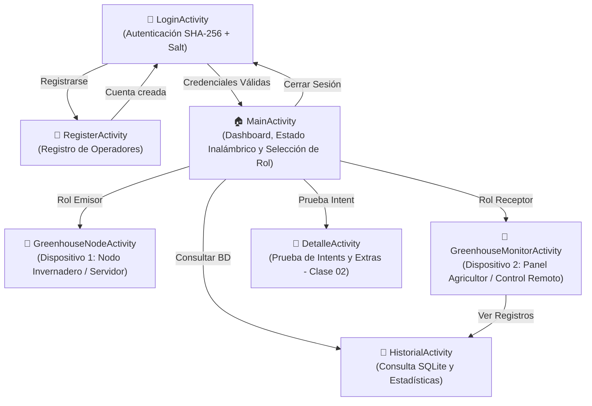

# TI3042 - Evaluación Sumativa Unidad 2: Invernadero Inteligente IoT

**Asignatura:** Aplicaciones Móviles para IoT (TI3042)  
**Estudiante:** Cristopher Toloza González  
**Docente:** Sebastián  
**Tema Seleccionado:** Caso 1 - Invernadero Inteligente de Bajo Costo  
**Tecnologías:** Android Studio | Kotlin | Sockets Inalámbricos (Wi-Fi / Bluetooth) | SQLite Local | Norma ISO 27400  

---

## 1. Identificación y Justificación de la Problemática (Paso 1)

### Contexto
En la producción agrícola y cultivos protegidos (invernaderos), el control del microclima es crítico. Variaciones drásticas de temperatura o humedad ambiental pueden causar estrés vegetal, proliferación de plagas o pérdida total de cosechas por heladas o golpes de calor. 

### Problemática Planteada
Los agricultores de comunidades locales a menudo no cuentan con sistemas industriales SCADA costosos para monitorear sus naves de cultivo en tiempo real ni para accionar mecanismos de ventilación de forma remota o automatizada sin trasladarse físicamente hasta el invernadero.

### Solución Desarrollada
Se implementa una aplicación móvil Android nativa en **Kotlin** que permite resolver la problemática mediante la **interconexión inalámbrica entre dos dispositivos Android**:
1. **Dispositivo 1 (Nodo Sensor Invernadero / Emisor):** Simula la estación de microcontrolador IoT ubicada en el invernadero agrícola. Monitorea y emula lecturas de un sensor **DHT11 (Temperatura y Humedad)**, controla el estado físico de un actuador de ventilación (Ventilador ON/OFF) y levanta un servidor de sockets inalámbricos local.
2. **Dispositivo 2 (Panel de Control y Monitoreo del Agricultor / Receptor):** Aplicación móvil del operador agrícola. Se conecta inalámbricamente al nodo del invernadero, visualiza la telemetría en tiempo real, emite alertas visuales cuando la temperatura supera el umbral crítico (> 28°C), envía comandos remotos de actuación (encender/apagar ventilador, alternar modo automático) y almacena el historial de lecturas en una base de datos local **SQLite**.

---

## 2. Herramientas de Desarrollo y Justificación Técnica (Criterio 2.1.1)

| Herramienta / Componente | Justificación Técnica y Estándar Android |
| :--- | :--- |
| **Android Studio & Kotlin** | Entorno oficial de desarrollo Android. Kotlin garantiza seguridad frente a nulos (`Null-Safety`), sintaxis concisa y compatibilidad total con corrutinas y ciclo de vida de componentes. |
| **ViewBinding** | Estándar recomendado por Google que sustituye `findViewById`, garantizando seguridad en tiempo de compilación frente a tipos y referencias nulas (`Type Safety` y `Null Safety`). |
| **Material Design 3** | Interfaz moderna, accesible, responsiva y ergonómica mediante `MaterialCardView`, `TextInputLayout`, `Buttons` y temas dinámicos. |
| **Sockets TCP Inalámbricos** | Protocolo de transporte orientado a conexión de baja latencia y alta confiabilidad para entornos OT/IoT en redes Wi-Fi locales o puntos de acceso portátiles (Hotspot), sin depender de pasarelas de pago ni servicios en la nube externos. |
| **SQLite Local (`SQLiteOpenHelper`)** | Almacenamiento relacional ligero embebido en el dispositivo. Proporciona persistencia 100% offline para telemetría y usuarios, garantizando operatividad continua en zonas rurales sin cobertura de internet. |
| **Coroutines (`kotlinx.coroutines`)** | Manejo de operaciones de red en hilos de fondo (`Dispatchers.IO`), evitando el bloqueo del hilo principal (`Main UI Thread`). |

---

## 3. Seguridad IoT: Cumplimiento de la Norma ISO/IEC 27400 (Criterio 2.1.3)

La aplicación sigue las directrices de la norma **ISO/IEC 27400** (Seguridad y Privacidad en el Internet de las Cosas) y lineamientos de entornos de Tecnología Operativa (OT):

1. **Protección de Credenciales (Anti-Cleartext Storage):**
   - Las contraseñas de los usuarios **nunca** se almacenan en texto plano en la base de datos SQLite.
   - Se utiliza **Hashing Criptográfico SHA-256** combinado con un **Salt aleatorio de 16 bytes** generado mediante `java.security.SecureRandom`.
   - Cada usuario posee una sal única, mitigando ataques de fuerza bruta y tablas Rainbow.
2. **Principio de Mínimo Privilegio (Least Privilege):**
   - La aplicación solo solicita los permisos estrictamente necesarios para la comunicación inalámbrica.
   - Antes de invocar el diálogo del sistema operativo, se despliega un **diálogo contextual explicativo** que informa al usuario por qué y para qué se requiere el permiso.
3. **Control de Acceso y Gestión de Sesiones:**
   - Para ingresar a las funciones de monitoreo y control del invernadero, es mandatorio autenticarse con credenciales válidas en la pantalla `LoginActivity`.
   - La sesión es gestionada por `SessionManager`, permitiendo cierre de sesión seguro (`Logout`).
4. **Protección de Registros (No Secret Leaks in Logs):**
   - En cumplimiento con ISO 27400, no se exponen contraseñas, hashes ni tokens sensibles en el `Logcat`.
5. **Sanitización de Entradas:**
   - Todos los campos de entrada de usuario son sanitizados para prevenir caracteres de control o intentos de inyección en SQLite.

---

## 4. Mapa de Pantallas y Navegación de la Aplicación



---

## 5. Matriz de Permisos Inalámbricos y Justificación

| Permiso Declarado en Manifest | Justificación Técnica bajo Mínimo Privilegio |
| :--- | :--- |
| `android.permission.INTERNET` | Requerido para abrir Sockets TCP locales y comunicar datos entre dispositivos en la red Wi-Fi o Hotspot. |
| `android.permission.ACCESS_NETWORK_STATE` | Permite verificar el estado de conexión de la interfaz de red local antes de iniciar transmisión. |
| `android.permission.ACCESS_WIFI_STATE` | Permite consultar el nombre de la red Wi-Fi (SSID) e información de enlace (Clase 03). |
| `android.permission.ACCESS_FINE_LOCATION` | Requerido por el sistema Android para resolver el SSID de la red Wi-Fi y escanear dispositivos Bluetooth. |
| `android.permission.ACCESS_COARSE_LOCATION` | Permiso de ubicación aproximada complementario para compatibilidad con APIs previas a Android 12. |
| `android.permission.BLUETOOTH` *(maxSdkVersion="30")* | Permite interactuar con adaptadores Bluetooth en versiones Android 11 o inferiores. |
| `android.permission.BLUETOOTH_CONNECT` *(API 31+)* | Permite comunicarse con dispositivos Bluetooth ya vinculados en Android 12+. |
| `android.permission.BLUETOOTH_SCAN` *(API 31+)* | Permite detectar dispositivos Bluetooth cercanos sin exponer datos de ubicación física. |

---

## 6. Demostración de Interconexión Inalámbrica (Criterio 2.1.4)

La aplicación implementa un protocolo cliente-servidor bidireccional sobre Sockets TCP (puerto `8080`) con paquetes JSON estructurados:

- **Paquete de Telemetría (Dispositivo 1 ➔ Dispositivo 2):**
  ```json
  {
    "temp": 28.5,
    "hum": 58.0,
    "fan": true,
    "alert": true,
    "mode": "AUTOMATICO",
    "time": "14:32:05"
  }
  ```
- **Comandos de Control Remoto (Dispositivo 2 ➔ Dispositivo 1):**
  - `CMD:FAN_ON`: Enciende inmediatamente el ventilador en el invernadero.
  - `CMD:FAN_OFF`: Apaga el ventilador en el invernadero.
  - `CMD:TOGGLE_MODE`: Alterna entre modo Automático y Manual.

### Guía de Demostración Paso a Paso (2 Teléfonos o Emuladores):

#### Opción A: Demostración con Dos Teléfonos Físicos
1. Conectar ambos teléfonos a la misma red Wi-Fi (o activar la **Zona Wi-Fi / Hotspot** en uno de ellos y conectar el segundo).
2. Abrir la aplicación en ambos teléfonos. En el Login, presionar **"Cargar Credenciales Demo"** e ingresar.
3. En el **Teléfono 1 (Nodo Invernadero):**
   - Seleccionar **"🌿 DISPOSITIVO 1: NODO INVERNADERO"**.
   - La pantalla mostrará en grande su IP local (ejemplo: `192.168.43.150:8080`) y el estado *"Servidor Activo"*.
4. En el **Teléfono 2 (Panel Agricultor):**
   - Seleccionar **"📱 DISPOSITIVO 2: PANEL AGRICULTOR"**.
   - En el campo IP, escribir la dirección mostrada por el Teléfono 1 (`192.168.43.150`) y presionar **"Conectar al Invernadero"**.
5. **Verificación de Interconexión en Tiempo Real:**
   - Al pulsar `+` o `-` en la temperatura del Teléfono 1, el Teléfono 2 se actualiza de inmediato.
   - Si la temperatura supera 28°C, se dispara la alerta visual en el Teléfono 2 y el Teléfono 1 activa el ventilador automáticamente.
   - Al pulsar **"🛑 Apagar"** o **"💨 Encender"** en el Teléfono 2, el ventilador del Teléfono 1 cambia de estado en tiempo real.
   - En el Teléfono 2, presionar **"📥 Guardar Lectura Actual en SQLite"** y luego **"Ver Historial SQLite"** para constatar la persistencia local.

#### Opción B: Demostración en un Solo Dispositivo (Modo Loopback)
1. Abrir la app e iniciar sesión.
2. Abrir **"Dispositivo 1: Nodo Invernadero"** (inicia el servidor en `127.0.0.1:8080`).
3. Volver y abrir **"Dispositivo 2: Panel Agricultor"**.
4. Presionar el botón rápido **"127.0.0.1"** y pulsar **"Conectar al Invernadero"**. Toda la telemetría y control operan de forma local.

---

## 7. Credenciales de Acceso Precargadas

| Usuario | Contraseña | Rol | Algoritmo Criptográfico |
| :--- | :--- | :--- | :--- |
| `admin` | `admin1234` | Supervisor de Invernadero | SHA-256 + Salt (16 bytes) |
| `agricultor` | `iot2026` | Operador Agrícola | SHA-256 + Salt (16 bytes) |

*(Nota: También es posible crear nuevos usuarios desde la pantalla de Registro; quedarán persistidos en la tabla `users` de SQLite).*

---

## 8. Registro de Ciclo de Vida (Logcat)

Todas las pantallas implementan trazabilidad en el ciclo de vida Android, permitiendo filtrar en Logcat mediante la etiqueta `CicloVida`:
- `CicloVida_Login`: eventos en LoginActivity.
- `CicloVida_Register`: eventos en RegisterActivity.
- `CicloVida_Main`: eventos en MainActivity.
- `CicloVida_Node`: eventos en GreenhouseNodeActivity.
- `CicloVida_Monitor`: eventos en GreenhouseMonitorActivity.
- `CicloVida_Historial`: eventos en HistorialActivity.
- `CicloVida_Detalle`: eventos en DetalleActivity.

---

## 9. Dirección de Arte y Sistema de Diseño: Temática Hollow Knight (Hallownest)

La interfaz móvil fue diseñada siguiendo la atmósfera, el lenguaje visual y el sistema de diseño del reino subterráneo de **Hollow Knight** (Team Cherry), integrando una arquitectura entomológica gótica de alta fidelidad:

| Elemento / Token | Implementación | Inspiración en Hallownest |
| :--- | :--- | :--- |
| **El Vacío (Void Black `#07080C`)** | Fondo base con viñeteado ambiental oscuro (`bg_void_vignette`). | El Vacío abisal y las profundidades de Hallownest. |
| **Alma Pura (Pure Soul `#F4F6F9`)** | Tipografía serif en mayúsculas (`letter-spacing: 0.15em`) para títulos y botones. | La energía de Alma que emana de las Vasijas. |
| **Mineral Pálido (`#6E7891`) y Piedra (`#3A4154`)** | Marcos de doble línea (*double-etched borders*) en contenedores y divisores ornamentales. | La forja del aguijón y la arquitectura tallada de Ciudad de Lágrimas. |
| **Savia Azul / Lifeblood (`#00B4D8` / `#72EFDD`)** | Valores de humedad relativa, enlaces y métricas de conexión. | La Savia Azul de las crisálidas de vida. |
| **La Infección / Radiance (`#FF7B00` / `#FFB703`)** | Banners y badges de alerta crítica cuando $T > 28^\circ\text{C}$. | El resplandor ardiente de la Infección. |
| **Sendero Verde / Greenpath (`#52B788`)** | Clima óptimo de cultivo, estados activos y confirmaciones. | La flora vibrante del Sendero Verde de Unn. |
| **Diario del Cazador** | Listado de telemetría SQLite en tarjetas de piedra con muescas de amuleto (`ic_charm_notch`). | Tablillas y registros de criaturas del Diario. |

